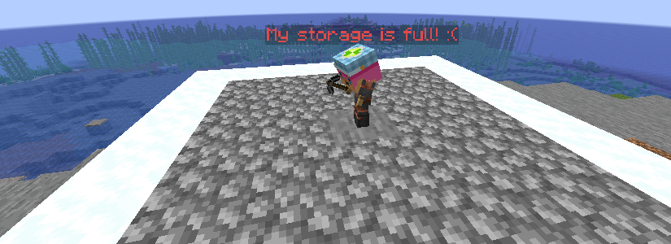
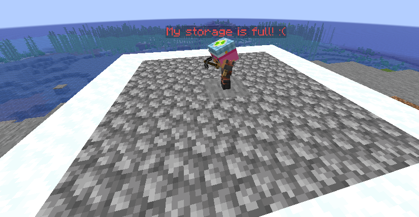
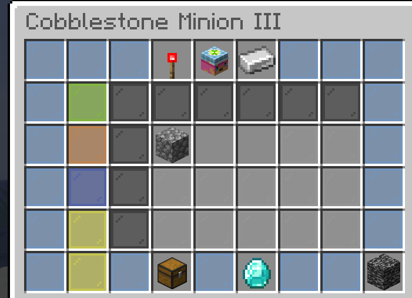

<p align="center">
  
</p>

# HypixelMinions

Hypixel SkyBlock style minions for **Paper 1.21.x**. Place a minion, give it some room, and it mines, farms or
chops for you, even while you're offline.

Made by [Iris (@Irisss01)](https://github.com/Irisss01). Unofficial fan project, not affiliated with Hypixel or Mojang.

<p align="center">
  
  
</p>

## Features
- 23 minions (mining, farming, foraging), 12 tiers each, with the SkyBlock-style 6-row minion menu
- The classic work loop: the minion fills its area with blocks, breaks one, puts a block back in the same spot,
  breaks the next one, and so on
- Fuels, upgrades (Compactor, Super Compactor 3000, Auto Smelter, Diamond Spreading, Flint Shovel, Minion Expander,
  Mithril Infusion, Free Will), Automated Shipping (Budget / Enchanted Hopper, needs Vault) and storage chests
- Compacting chain, e.g. Lapis -> Enchanted Lapis Lazuli -> Enchanted Lapis Block
- Minion Skin slot and per-tier head textures
- Smooth armor stand animations (turning, placing, pickaxe swings, cracking stages, particles, sounds)
- Works offline / in unloaded chunks and catches up when the server runs again
- Crafting table recipes, minion slot limits (unlocked by crafting unique minions)

## Requirements
- Paper 1.21.x (built against 1.21.4) and Java 21
- Optional: [Vault](https://www.spigotmc.org/resources/vault.34315/) + an economy plugin for Automated Shipping

## Install
```
mvn package
```
Copy `target/HypixelMinions.jar` into your server's `plugins/` folder and start the server.

## How it works
- The working area is the 5x5 layer the minion stands **on** (one block down). Dig a 5x5 hole 1 deep around the
  spot. Crop minions need farmland in that layer. A Minion Expander makes it 7x7.
- Right-click a minion to open its menu. Pick it up with the bedrock button (click twice to confirm).
- Menu: ideal layout, info head, next tier, fuel, skin, shipping, two upgrade slots, collect all, stats.
  Shift-click a fuel / upgrade / hopper / skin head in your inventory to put it in the right slot.

### Getting minions
- `/minions` opens the catalog (needs `minions.catalog`, op by default)
- Crafting table:
  - Tier I: ring of 10 resource around the wooden tool (pickaxe / shovel / hoe / axe)
  - Tier up: ring of the tier's cost around the previous-tier minion (II-XI), tier XII in the minion menu
  - Enchanted item: "+" shape, 5 slots x 32 of the same resource
  - Enchanted block: "+" shape, 5 slots x 32 of the same enchanted item
  - Small Storage: ring of 8 oak logs, empty centre

### Compacting
<p align="center"></p>

Compactor: 160 of an item -> 1 Enchanted version. Super Compactor 3000 also turns 160 Enchanted items into 1
Enchanted Block (Lapis, Coal, Iron, Gold, Diamond, Redstone, Emerald, Quartz). Enchanted Blocks count as 160
enchanted items when upgrading a minion. The menu shows which upgrades work on each minion, for example Auto Smelter
does nothing on a Lapis minion.

### Skins
<p align="center"></p>

Heads are picked in this order: `textures` in `config.yml`, then `skins.yml`, then the built-in Cobblestone set,
then a helmet dyed in the minion's colour.

To fill `skins.yml` for every minion and tier (needs internet, run once):
```
python3 tools/import_hypixel_skins.py --out plugins/HypixelMinions/skins.yml
```
then `/minions reload`. The textures are downloaded from the public
[NotEnoughUpdates-REPO](https://github.com/NotEnoughUpdates/NotEnoughUpdates-REPO). You can also hold any custom
head and run `/minions texture <minion> hand [tier]`.

## Commands and permissions
| Command | What it does |
|---|---|
| `/minions` | open the catalog |
| `/minions give <player> <id> [tier\|amount]` | give a minion, fuel, upgrade, storage, `enchanted_<minion>` or `enchantedblock_<minion>` |
| `/minions list` | list all placed minions |
| `/minions reload` | reload config and skins |
| `/minions texture <minion> <url\|hash\|base64\|hand> [tier]` | set a head texture |

| Permission | Default |
|---|---|
| `minions.use` | everyone |
| `minions.catalog` | op |
| `minions.admin` | op |
| `minions.bypass` | op (ignore the slot limit) |
| `minions.slots.<N>` | none (grants N slots) |

## Configuration
Everything is in `config.yml`: slots, animations, working layer, offline cap, speed overrides per minion, fuel
overrides, shipping prices and head textures. Each option has a comment.

## Contributing
Issues and pull requests are welcome. To add a minion, add a constant to `MinionType`.

## License
[MIT](LICENSE) (c) 2026 Iris
